<p align="center">
  
</p>

<h1 align="center">DARKBYTE ARES</h1>

<p align="center">
  <strong>ONE FRAMEWORK. COMPLETE RED TEAM OPERATIONS.</strong><br />
  An authorization-first security assessment platform for scoped offensive operations, evidence-backed findings and detection engineering.
</p>

<p align="center">
  
  
  
  
  
</p>

> [!WARNING]
> **Authorized use only.** DARKBYTE ARES is built for defensive teams, security labs and explicitly authorized assessments. Every operation requires a verified target record with a written authorization reference, an expiry and an explicit action allowlist. You are solely responsible for obtaining and retaining permission to test every system you assess. The project does not support unauthorized access, exploitation, malware, credential theft, persistence, evasion or denial of service.

---

## Overview

DARKBYTE ARES is a self-hosted security operations console that brings ten scoped assessment workflows, a persistent job queue, CVSS/CVE intelligence, MITRE ATT&CK mapping, evidence-backed findings and PDF/HTML/JSON reporting into one dark, responsive interface.

It is designed around a simple principle: **authorization is a precondition, not a checkbox**. Targets cannot be assessed until an administrator verifies the written scope. Every engine re-validates that scope immediately before execution, and every material action is appended to a tamper-evident audit chain.

The console ships with a clearly labelled demonstration dataset for screenshots and workflow evaluation. Demo records are marked `is_demo=true`, are visibly badged in the UI and are rejected by the target authorization layer when `APP_ENV=production`.

### Screenshots

| Command dashboard | Authentication |
| --- | --- |
| 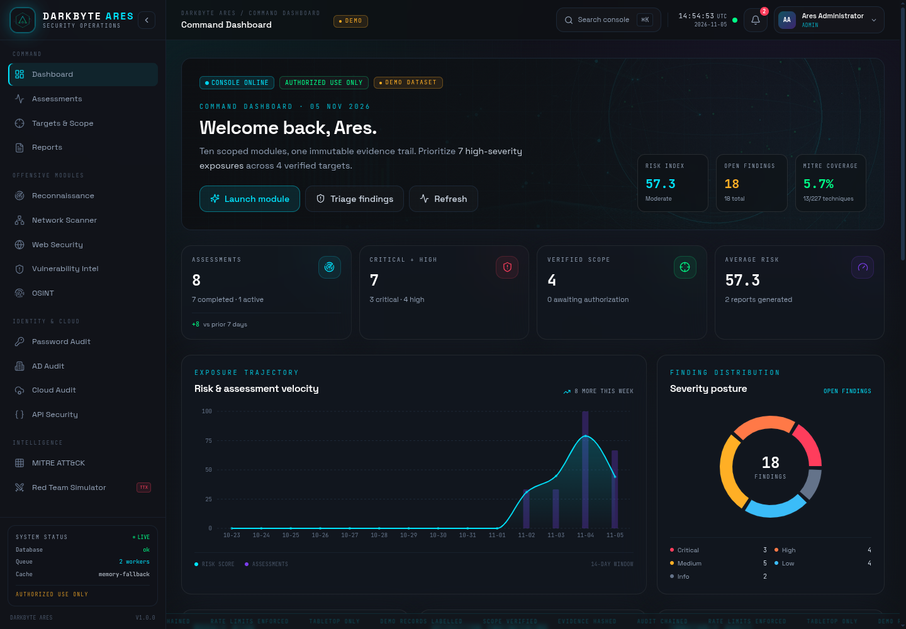 | 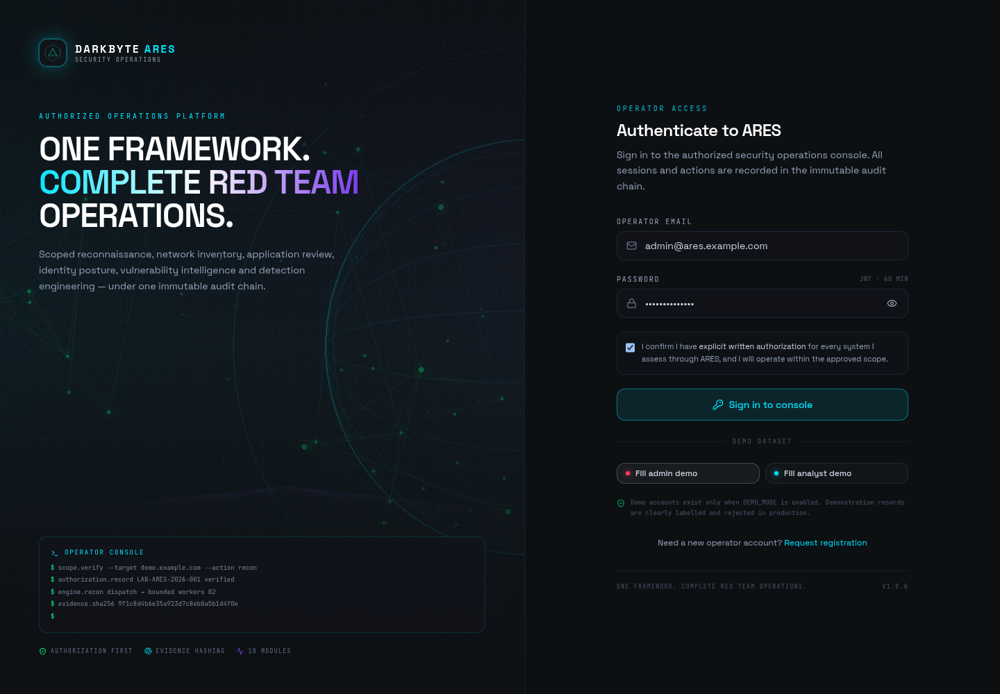 |
| **Assessments** | **Targets and scope** |
| 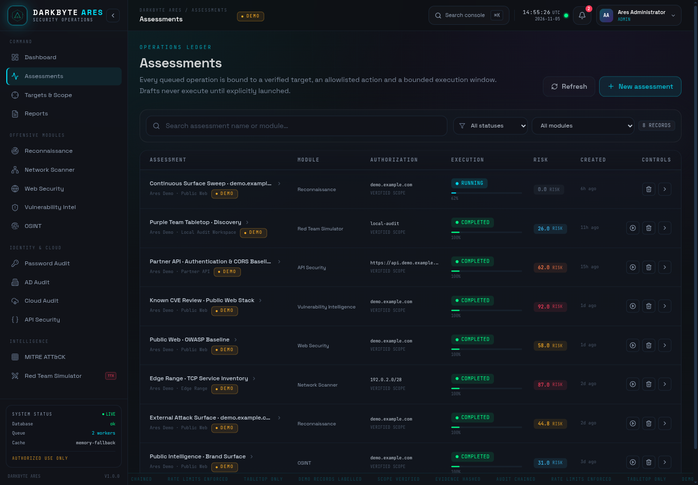 | 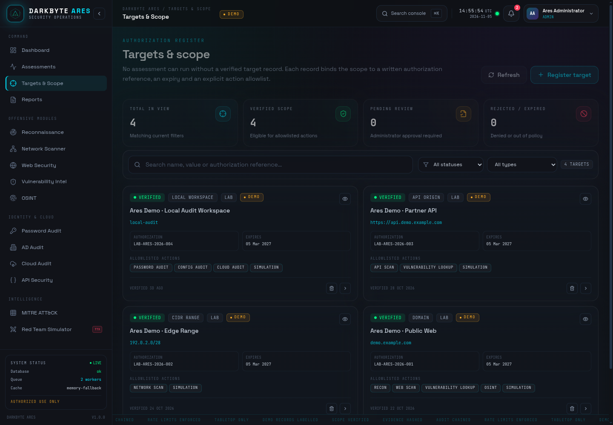 |
| **Findings triage** | **MITRE ATT&CK coverage** |
| 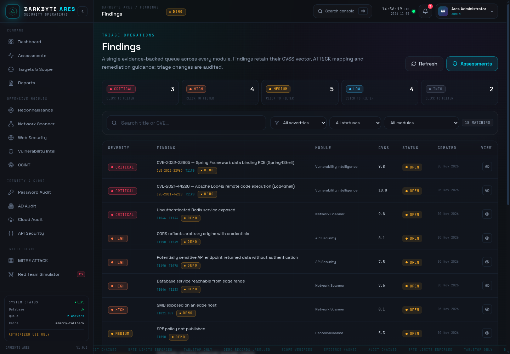 | 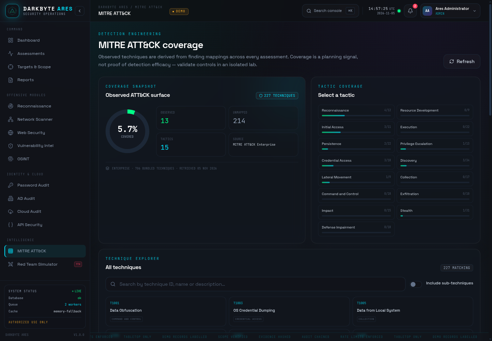 |
| **Module console** | **Reports** |
| 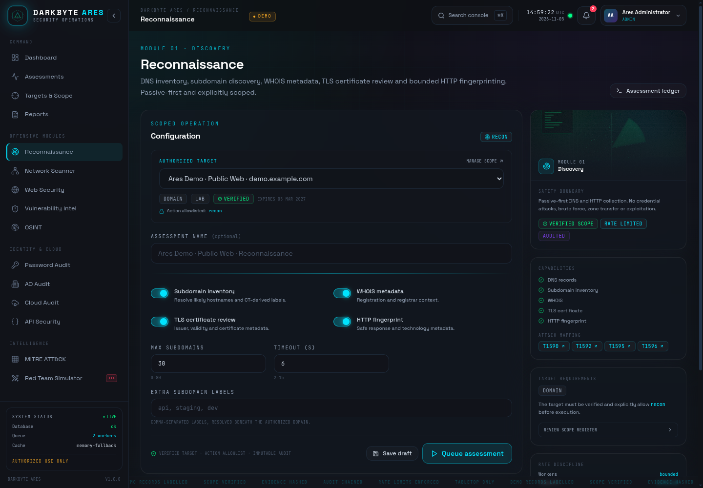 | 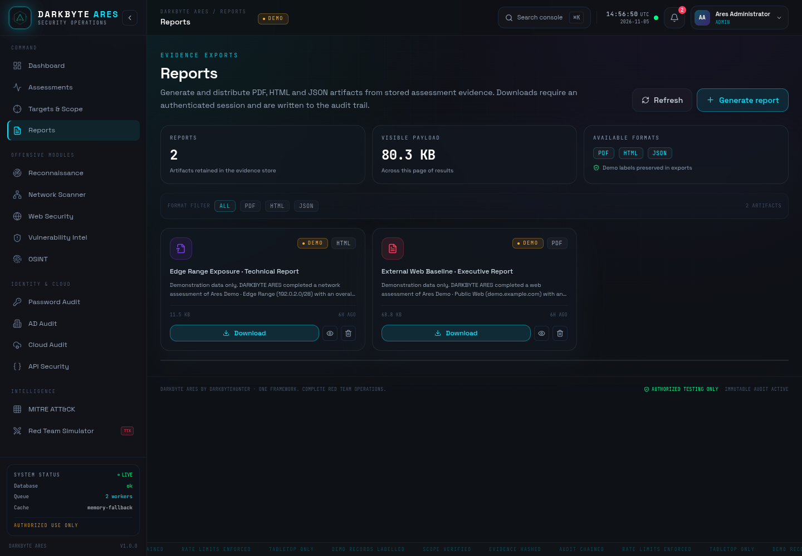 |
| **Assessment detail** | **Settings** |
| 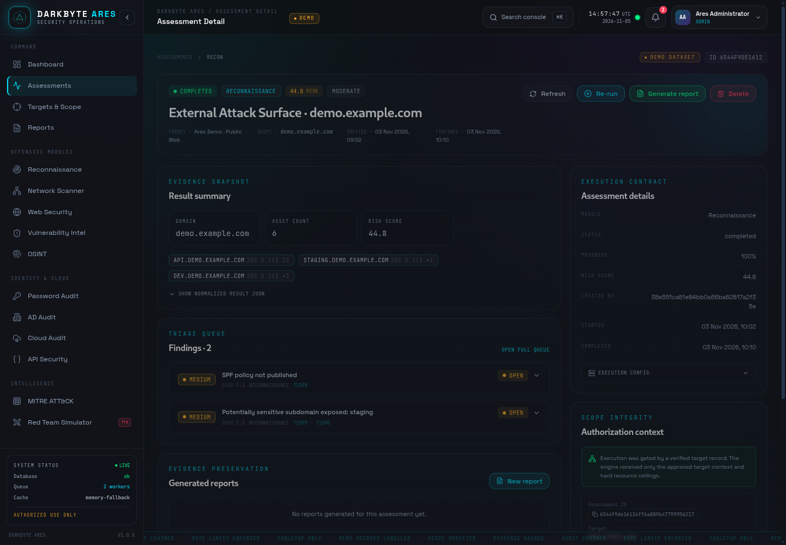 | 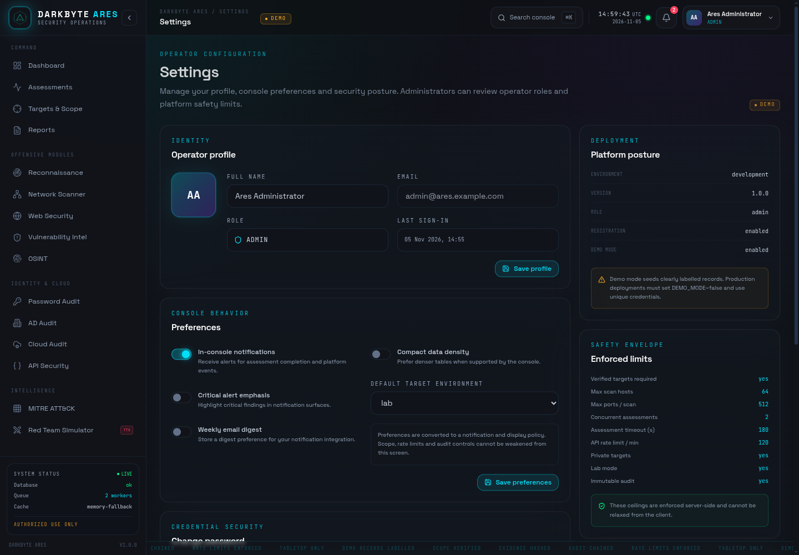 |

<p align="center">
  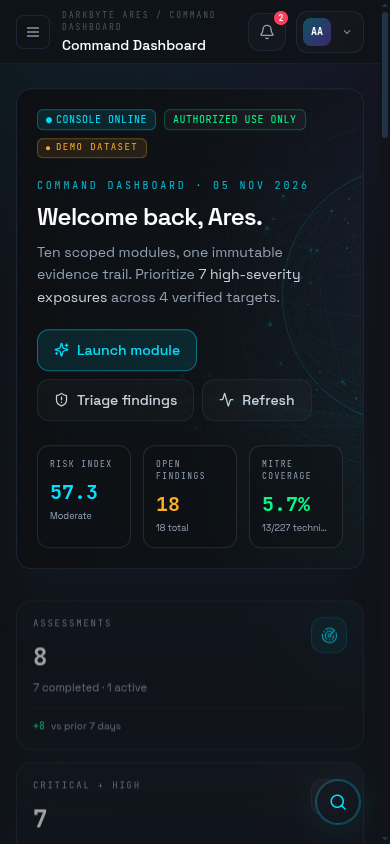
</p>

> Screenshots use **demo mode** and the visibly labelled demonstration dataset. No live scan produced these results.

---

## Feature set

- **Ten assessment modules** for reconnaissance, network inventory, web exposure, vulnerability intelligence, OSINT, password hygiene, Active Directory posture, cloud posture, API exposure and tabletop attack planning.
- **Authorization workflow** with written authorization references, admin verification, action allowlists, expiry enforcement and per-module target-type checks.
- **Persistent assessment queue** backed by `scan_jobs`, with bounded workers, restart recovery, cancellation and hard timeouts.
- **Evidence and reporting** with CVSS v3 scoring, CVE/CWE mapping, ATT&CK technique IDs and PDF, HTML and JSON deliverables.
- **MITRE ATT&CK explorer** with 706 bundled techniques across 15 tactics, coverage calculations and friendly attribution.
- **Defensive safety controls** including per-IP request limits, tighter active-assessment limits, server-side input validation, protected target ranges, RBAC and no client-overridable safety ceilings.
- **Tamper-evident audit chain** using a SHA-256 hash chain, redaction of secret-shaped fields and an admin verification endpoint.
- **Operations console** with a 15-entry primary navigation, global search, notification centre, profile/settings, findings triage, audit viewer and plugin management.
- **Demo data separation** for safe screenshots and training, with production boot refusing demo mode.
- **Docker Compose stack** with PostgreSQL, Redis, a non-root API container and an nginx-served SPA.

---

## Modules

| # | Module | Primary target types | What it does |
| --- | --- | --- | --- |
| 01 | **Reconnaissance** | `domain` | DNS inventory, bounded subdomain discovery, WHOIS, TLS certificate review and safe HTTP fingerprinting. |
| 02 | **Network Scanner** | `ip`, `cidr` | TCP connect inventory with hard host/port/concurrency ceilings and an optional Nmap XML path for labs. |
| 03 | **Web Security** | `url`, `domain` | OWASP-aligned header, TLS, cookie and sensitive-file review. Injection probes are lab-gated and off by default. |
| 04 | **Vulnerability Intelligence** | `domain`, `url`, `local` | NVD CVE lookup with a bundled dated snapshot for offline resilience, CVSS v3 scoring and CWE mapping. |
| 05 | **OSINT** | `domain` | DNS, WHOIS, certificate transparency and authorized public-document metadata. Document bytes are never stored. |
| 06 | **Password Audit** | `local`, `password_policy` | In-memory strength scoring and bounded offline dictionary audit. Plaintext and hashes are never persisted or returned. |
| 07 | **AD Audit** | `local`, `ad_config` | Read-only review of an exported AD snapshot: password policy, Kerberos posture, privileged groups and delegation. |
| 08 | **Cloud Audit** | `local`, `cloud_account` | Read-only review of exported AWS/Azure/GCP configuration snapshots for IAM, storage, logging and network exposure. |
| 09 | **API Security** | `api`, `url` | Bounded GET/OPTIONS checks for anonymous exposure, CORS policy, security headers and rate-limit evidence. |
| 10 | **Red Team Simulator** | Any verified target type | **Tabletop-only** ATT&CK attack-chain and detection-engineering exercises. No technique is executed. |

The console exposes exactly **15 primary sidebar entries** across Dashboard, Assessments, Targets & Scope, Reports, the ten modules and MITRE ATT&CK. Findings, notifications, settings, audit and plugins remain reachable from the dashboard, topbar, profile menu and settings.

See [docs/modules.md](docs/modules.md) for configuration fields, target requirements, evidence behaviour and limitations.

---

## Architecture

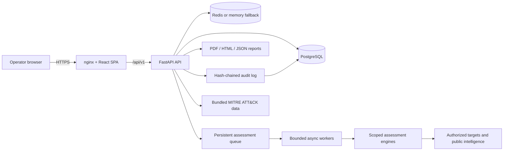

| Component | Responsibility |
| --- | --- |
| **React + TypeScript console** | 15-entry navigation, module forms, findings triage, dashboards, reports, settings and responsive mobile layout. |
| **FastAPI API** | Authentication, RBAC, target authorization, assessment lifecycle, findings, reporting, MITRE, notifications and audit endpoints. |
| **PostgreSQL / SQLite** | Durable platform state. PostgreSQL is the Docker default; SQLite is the zero-dependency development fallback. |
| **Redis / memory cache** | Rate-limit windows, login throttling and short-lived dashboard caching. Redis is optional in development. |
| **Persistent queue** | `scan_jobs` rows plus in-process bounded workers. Queued and interrupted jobs are recovered on restart. |
| **Assessment engines** | Separate Python packages under `engines/`, each receiving a validated `RunContext` and returning typed findings. |
| **Reporting service** | Renders the same evidence set as PDF, standalone HTML and JSON under `REPORTS_DIR`. |

The API is versioned under `/api/v1`; interactive OpenAPI documentation is available at `/docs`. See [docs/architecture.md](docs/architecture.md) for the request lifecycle, queue design, data model and security boundaries.

---

## Safety model

DARKBYTE ARES deliberately limits what can be automated:

- **Verified scope required.** A target must have a written authorization reference, an authorizer, an optional expiry and an action allowlist. An administrator verifies the record before any assessment can start.
- **Defense in depth.** The API validates scope when an assessment is created, when it is queued and again inside the worker immediately before engine execution.
- **Hard ceilings.** Host counts, ports, concurrency, DNS/HTTP timeouts, assessment duration and worker counts are server-side settings validated at boot. Clients cannot raise them.
- **Public-address discipline.** Cloud metadata addresses are always blocked. Private and loopback targets require lab/staging scope and the corresponding server flags.
- **No credential persistence.** Password audits process plaintext, hashes and wordlists in memory. Only aggregate counts and findings are stored. OSINT documents are hashed for provenance, never stored.
- **Tabletop red teaming.** The red-team module generates planning findings and detection hypotheses. It executes no techniques and generates no adversary traffic.
- **No exploitation or malware.** Engines perform bounded discovery and configuration review. SQL injection/reflection probes are disabled by default and lab-gated.
- **Append-only audit trail.** Security-relevant actions are recorded with a SHA-256 hash chain and a verification endpoint. Secret-shaped fields are redacted before persistence.
- **Demo cannot masquerade as production.** Demo assessments, findings, targets and reports are marked in the API and UI. Production refuses to boot with `DEMO_MODE=true`, and demo records are rejected by the authorization layer.

Read the full policy in [SECURITY.md](SECURITY.md) and the deployment checklist in [docs/deployment.md](docs/deployment.md).

---

## Quick start

### Docker Compose (recommended)

Requirements: Docker Engine 24+ with Compose v2.

```bash
git clone https://github.com/degalapardhiv/DARKBYTE-ARES.git
cd darkbyte-ares
cp .env.example .env
# Edit .env before exposing the app. Demo mode is enabled by default.
docker compose up --build
```

| Service | URL |
| --- | --- |
| Console | http://localhost:8080 |
| API | http://localhost:8000 |
| OpenAPI / Swagger UI | http://localhost:8000/docs |
| Health | http://localhost:8000/health |

The Compose stack starts PostgreSQL, Redis, the API and the nginx-served console. The API container runs as a non-root user and includes a health check; the frontend waits for it before starting.

**Demo credentials (only while `DEMO_MODE=true`):**

| Role | Email | Password |
| --- | --- | --- |
| Administrator | `admin@ares.example.com` | `Ares!Admin2026` |
| Analyst | `analyst@ares.example.com` | `Ares!Analyst2026` |

Demo accounts and data are seeded only when the database has no demo dataset. Change or remove them before any shared deployment.

### Local development

Requirements: Python 3.12+, Node.js 20+ and npm 10+.

```bash
python3.12 -m venv .venv
source .venv/bin/activate
pip install -r requirements.txt -r requirements-dev.txt

cp .env.example .env
# Set a unique SECRET_KEY. Redis is optional locally; ARES falls back to memory.

uvicorn backend.main:app --reload --port 8000
```

In a second terminal:

```bash
cd frontend
npm ci
npm run dev
```

Open http://localhost:5173. The Vite development proxy forwards `/api` to `http://localhost:8000`.

To create an administrator without using the demo seed:

```bash
# Disable demo mode in .env first, then run interactively.
.venv/bin/python scripts/create_admin.py --email admin@your-domain.example
```

The script prompts for the password, validates it, never echoes it and stores only a salted PBKDF2 hash.

---

## Typical assessment workflow

1. **Record the authorization.** Create a target with its type, value, environment, written authorization reference, authorizer, expiry and permitted actions.
2. **Verify the scope.** An administrator reviews the record and verifies it. Scope edits by non-admins or changes to a verified record return it to `pending`.
3. **Create an assessment.** Choose a module and a target whose type and allowlist permit that action.
4. **Queue it.** The API re-validates scope, applies the active-assessment rate limit and writes a durable job.
5. **Run bounded workers.** A worker re-validates the target, enforces the assessment timeout and stores evidence-backed findings.
6. **Triage and report.** Update finding status, map coverage, then generate a PDF, HTML or JSON report. Downloads require an authenticated request.

Assessments can also be saved as drafts (`start: false`) and run later. Password auditing is synchronous and never enters the queue so plaintext never reaches durable storage.

---

## Configuration

All settings are environment-backed and validated at startup. Copy [.env.example](.env.example) and change every secret before deployment.

| Setting | Default | Purpose |
| --- | --- | --- |
| `APP_ENV` | `development` | `development`, `test`, `staging` or `production`. Production enforces stricter boot checks. |
| `DEMO_MODE` | `true` | Seeds labelled demo users/data. **Must be `false` in production.** |
| `SECRET_KEY` | development placeholder | JWT signing key. Use a unique 32+ character random value in production. |
| `ALLOW_REGISTRATION` | `true` | Enables self-service registration. Disable when accounts are centrally managed. |
| `DATABASE_URL` | SQLite file | SQLAlchemy async URL. Compose overrides it with PostgreSQL. |
| `REDIS_URL` | `redis://localhost:6379/0` | Redis for shared cache/rate limits. Empty or unavailable falls back to memory. |
| `ALLOWED_ORIGINS` | localhost origins | Comma-separated exact CORS origins. Wildcards are rejected in production. |
| `REQUIRE_VERIFIED_TARGETS` | `true` | Rejects assessments on unverified targets. Keep enabled. |
| `ALLOW_PRIVATE_TARGETS` | `true` | Allows private ranges for lab/staging scope. Set `false` in production unless required. |
| `ALLOW_LOOPBACK_LAB` | `true` | Allows loopback only for lab-scoped targets. |
| `MAX_SCAN_HOSTS` | `64` | Hard per-assessment host ceiling (maximum configurable value: 256). |
| `MAX_PORTS_PER_SCAN` | `512` | Hard per-assessment port ceiling (maximum configurable value: 2048). |
| `MAX_CONCURRENT_ASSESSMENTS` | `2` | Queue worker count (1–8). |
| `ASSESSMENT_TIMEOUT_SECONDS` | `180` | Hard engine timeout (15–900 seconds). |
| `RATE_LIMIT_PER_MINUTE` | `120` | Per-IP API request limit. |
| `ACTIVE_SCAN_RATE_LIMIT` | `30` | Per-user active assessment starts per minute. |
| `NVD_API_KEY` | empty | Optional NVD key for higher rate limits. |
| `REPORTS_DIR` | `./data/reports` | Report storage directory. |
| `ADMIN_EMAIL` / `ADMIN_PASSWORD` | demo values | Demo seed credentials; when demo mode is off, provisions the first administrator if the database has no users (a strong password of 12+ characters is required). |

The full list, including NVD/MITRE/CT endpoint overrides, is in [.env.example](.env.example) and [docs/deployment.md](docs/deployment.md).

> Generate a production secret with:
> `python -c "import secrets; print(secrets.token_urlsafe(48))"`

---

## API

Base URL: `/api/v1` (for example `http://localhost:8000/api/v1`). All API routes except health require a bearer token.

```bash
# Sign in
curl -s http://localhost:8000/api/v1/auth/login \
  -H 'Content-Type: application/json' \
  -d '{"email":"admin@ares.example.com","password":"Ares!Admin2026"}'

# List verified scope
curl -s http://localhost:8000/api/v1/targets?status=verified \
  -H "Authorization: Bearer $ARES_TOKEN"
```

Responses use a consistent error envelope:

```json
{
  "error": {
    "code": "target_not_authorized",
    "message": "The scope allowlist does not permit 'recon' for target 'Example'.",
    "details": {}
  }
}
```

List endpoints return `{ "items": [...], "total": N, "limit": N, "offset": N }`. Reports stream as file downloads and therefore require the `Authorization` header (the console downloads them as blobs).

Key endpoint groups:

| Group | Representative endpoints |
| --- | --- |
| Authentication | `POST /auth/register`, `POST /auth/login`, `GET /auth/me`, `POST /auth/change-password` |
| Targets & scope | `GET/POST /targets`, `PATCH /targets/{id}`, `POST /targets/{id}/verify`, `POST /targets/{id}/reject` |
| Assessments | `GET/POST /assessments`, `POST /assessments/{id}/run`, `POST /assessments/{id}/cancel` |
| Findings | `GET /findings`, `PATCH /findings/{id}` |
| Modules & tools | `GET /modules`, `POST /tools/cvss`, `POST /tools/password-audit` |
| Intelligence | `GET /mitre/tactics`, `GET /mitre/techniques`, `GET /mitre/coverage` |
| Reports | `GET/POST /reports`, `GET /reports/{id}/download` |
| Operations | `GET /dashboard`, `GET /notifications`, `GET /audit`, `GET /audit/verify`, `GET /plugins` |

The complete reference, including request bodies, roles and pagination parameters, is in [docs/api.md](docs/api.md). The live schema is at `/openapi.json` and `/docs`.

---

## Reporting

Reports are generated from stored assessments and findings:

- **PDF** — branded, paginated executive and technical report.
- **HTML** — self-contained, print-friendly deliverable.
- **JSON** — machine-readable evidence and finding payload.

Report files are written below `REPORTS_DIR`; download paths are resolved and checked against that root to prevent traversal. Generation and download actions are audited. Demo reports are labelled as demonstration data in the report body and metadata.

---

## Testing and quality gates

```bash
# Backend
.venv/bin/ruff check backend engines integrations scripts tests
.venv/bin/python -m pytest -q

# Frontend
cd frontend
npm run lint
npm run test
npm run build
```

A `Makefile` wraps the same gates: `make check` runs lint, tests and the production build after `make install`.

The repository includes **21 backend tests** covering authentication, RBAC, target verification/expiry, scope enforcement, configuration validation, password non-persistence, CVSS, reports, notifications, MITRE, the audit chain and queued tabletop execution, plus **25 frontend tests** for shared utilities and UI primitives. GitHub Actions runs Ruff, pytest, ESLint, Vitest, the production build, Compose validation and both Docker image builds; see [.github/workflows/ci.yml](.github/workflows/ci.yml).

---

## Project structure

```text
darkbyte-ares/
├── backend/              FastAPI app, API routers, auth, models, services
│   ├── api/              Versioned API contracts
│   ├── core/             Config, security, errors, logging, rate limiting
│   ├── database/         Async SQLAlchemy engine and sessions
│   ├── models/           Users, targets, assessments, findings, jobs, reports
│   └── services/         Authorization, queue, audit, reporting, seeding, plugins
├── engines/              Ten assessment engines + shared result model
├── integrations/         NVD client, bundled MITRE ATT&CK data, Nmap wrapper
├── frontend/             React + TypeScript + Tailwind console
│   ├── public/assets/    Original logo, hero, module and background artwork
│   └── src/              Pages, components, contexts, API client and tests
├── reporting/            HTML report template
├── plugins/              Trusted local plugin example (disabled by default)
├── scripts/              Asset generation, MITRE refresh, admin provisioning
├── tests/                Isolated pytest suite
├── docs/                 Architecture, API, modules, deployment and screenshots
├── docker-compose.yml    Development stack
├── docker-compose.prod.yml
└── Dockerfile            Non-root API image
```

---

## Documentation

- [Architecture and request lifecycle](docs/architecture.md)
- [API reference](docs/api.md)
- [Module and configuration reference](docs/modules.md)
- [Deployment and operations](docs/deployment.md)
- [Security policy](SECURITY.md)
- [Contributing guide](CONTRIBUTING.md)

---

## Deployment notes

For production, use the hardening overlay and supply every required secret from the host environment:

```bash
export SECRET_KEY="$(python -c 'import secrets; print(secrets.token_urlsafe(48))')"
export POSTGRES_PASSWORD="$(python -c 'import secrets; print(secrets.token_urlsafe(24))')"
export ADMIN_EMAIL="admin@your-domain.example"
export ADMIN_PASSWORD="$(python -c 'import secrets; print(secrets.token_urlsafe(24))')"
export ALLOWED_ORIGINS="https://ares.your-domain.example"

docker compose -f docker-compose.yml -f docker-compose.prod.yml up -d --build
```

The production overlay:

- disables demo mode and self-service registration by default;
- removes published PostgreSQL, Redis and direct API ports;
- requires a strong `SECRET_KEY`, `POSTGRES_PASSWORD`, administrator credentials and explicit CORS origins;
- sets `ALLOW_PRIVATE_TARGETS=false` and `ALLOW_LOOPBACK_LAB=false` unless overridden deliberately.

Put TLS in front of the console (the bundled nginx serves port 80 behind your reverse proxy), keep PostgreSQL and Redis private, restrict egress, back up the database and report directory, and review the audit chain regularly. See [docs/deployment.md](docs/deployment.md).

---

## Demo data policy

Demo mode exists so the console can be evaluated without touching real systems.

- Demo users, targets, assessments, findings, notifications and reports carry `is_demo=true`.
- The UI displays a **DEMO** badge, and reports start with a demonstration-data notice.
- Demo targets use reserved/documentation values such as `demo.example.com` and `192.0.2.0/28`; seeding performs no scans.
- Production boot fails when `DEMO_MODE=true`, and the authorization layer refuses demo targets in production.
- Running an assessment against a demo target in development still executes the real engine. Use drafts or non-active modules if you do not want any outbound traffic.

No fake scan results are presented as production evidence.

---

## Contributing

Contributions are welcome when they strengthen defensive value, safety and code quality. Read [CONTRIBUTING.md](CONTRIBUTING.md) first. In short: no authorization bypasses, no exploitation or credential theft, no audit weakening and no plaintext secret persistence.

Security reports should follow [SECURITY.md](SECURITY.md) and must not be filed as public issues.

---

## Credits and license

- **Author:** DarkByteHunter
- **MITRE ATT&CK:** bundled technique/tactic data is derived from the MITRE ATT&CK knowledge base. MITRE ATT&CK is a registered trademark of The MITRE Corporation. See the bundled attribution metadata in `integrations/mitre_attack/`.
- **NVD:** vulnerability intelligence uses the NIST National Vulnerability Database API, with a dated offline snapshot.
- **Fonts:** Space Grotesk and JetBrains Mono via `@fontsource`.
- **Artwork:** original DARKBYTE ARES illustrations, logo and icons, generated for this project by `scripts/generate_assets.py`.

Released under the [MIT License](LICENSE).

<p align="center">
  <strong>DARKBYTE ARES</strong><br />
  <sub>Authorization first. Evidence always. No uncontrolled offense.</sub>
</p>
