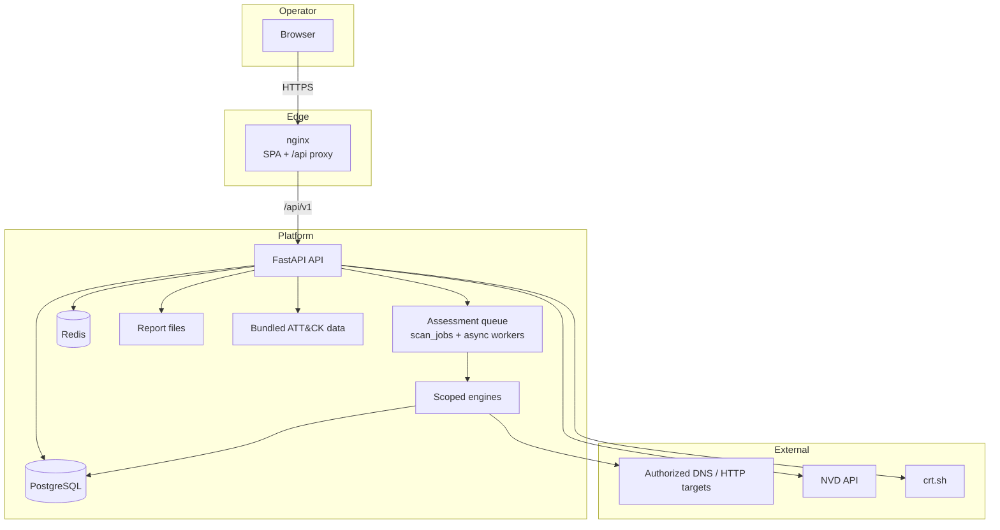
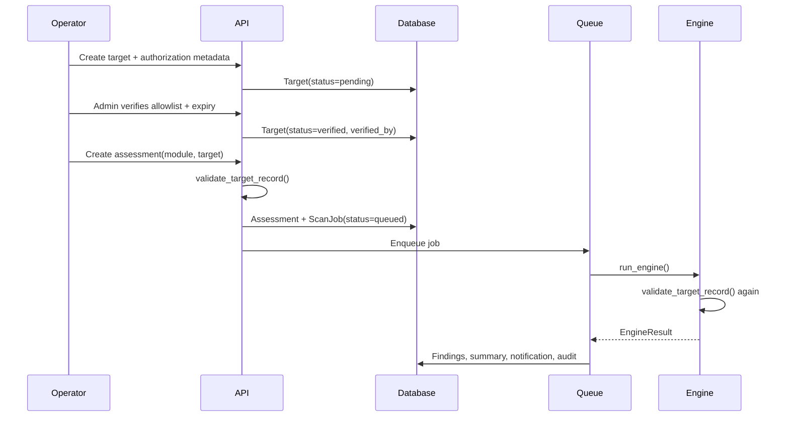

# Architecture

DARKBYTE ARES is a single-repository, self-hosted assessment platform. The
architecture optimizes for three properties: **scope enforcement**, **durable
evidence** and **operational clarity**. Offensive capability is deliberately
bounded; the platform is not an exploitation framework.

## System context



The browser never talks to PostgreSQL, Redis or engines directly. The API is the
only trusted boundary and the queue is the only path to engine execution.

## Runtime components

### API (`backend/`)

FastAPI application with:

- `/api/v1` versioned routers for auth, targets, assessments, findings,
  dashboard, reports, modules/tools, MITRE, plugins, notifications and platform.
- JWT bearer authentication using HS256, with an `iss`/`aud` pair and configurable
  expiry. Tokens contain the user ID and role; the user is re-read on each
  request.
- Role checks through dependencies (`admin`, `analyst`, `viewer`). Viewers can
  read; analysts can create targets/assessments and triage findings; admins can
  verify scope, manage users and control plugins.
- Normalized error envelopes, request IDs, security headers and a coarse per-IP
  rate limit.
- OpenAPI schema at `/openapi.json`, Swagger UI at `/docs` and ReDoc at `/redoc`.
- Startup lifespan that initializes the schema, connects the cache, seeds the
  database and starts queue workers; shutdown cancels workers and closes
  connections.

### Database (`backend/database/`)

Async SQLAlchemy 2.0 with `asyncpg` for PostgreSQL and `aiosqlite` for local
development/tests. Tables are created with `Base.metadata.create_all()` at boot;
this project intentionally ships without a migration framework for its first
release. Production deployments should introduce Alembic before changing model
schemas in place.

### Cache and rate limiting (`backend/services/cache.py`)

Redis is used for:

- per-IP request counters (`RATE_LIMIT_PER_MINUTE`);
- per-user active-assessment counters (`ACTIVE_SCAN_RATE_LIMIT`);
- login-failure throttling (six failures per email/IP pair in ten minutes);
- a short-lived dashboard overview cache.

If Redis is unavailable, the process falls back to an in-memory cache. The
fallback is suitable for a single development process; production should use
Redis so limits are shared and survive restarts.

### Persistent assessment queue (`backend/services/queue.py`)

The queue uses a database row (`scan_jobs`) plus an in-process
`asyncio.Queue`:

1. An API request validates scope and calls `enqueue()`.
2. The job row and assessment status are committed as `queued`.
3. A bounded worker pool (size `MAX_CONCURRENT_ASSESSMENTS`) picks up the job.
4. The worker re-loads the assessment and target, sets `running`, and re-validates
   scope with `validate_target_record`.
5. The engine runs with `asyncio.wait_for(...)` using
   `ASSESSMENT_TIMEOUT_SECONDS`.
6. On success, previous findings for the assessment are replaced, findings and
   summary are stored, a notification is created, and completion is audited.
7. On failure, the job and assessment are marked failed with a bounded error
   message; attempts are tracked in `scan_jobs`.

At startup, queued jobs and previously running jobs are recovered. A single
process owns the worker pool; if you scale the API horizontally, move the worker
loop into a dedicated process or service so two pools do not compete for the same
job rows.

Cancellation is supported only while a job is still queued. The API marks the
job and assessment cancelled; a worker that later picks up the stale job ID sees
the non-queued state and exits without running the engine. A running assessment
cannot be cancelled from the API and must be allowed to finish or time out.

### Engines (`engines/`)

Each engine implements:

```python
async def run(context: RunContext, config: dict) -> EngineResult
```

`RunContext` contains validated settings, the target payload, the target
environment and whether the record is demo data. Engines return `EngineResult`
with `FindingDraft` objects. Shared scoring in `engines/base.py` converts
findings to a 0–100 risk score using worst-case CVSS, average CVSS and finding
breadth.

Engine boundaries:

| Engine | Network behaviour | Durable secrets |
| --- | --- | --- |
| Reconnaissance | Public DNS, WHOIS, TLS, bounded HTTP HEAD/GET | None |
| Network Scanner | TCP connect to authorized hosts/ports; optional local Nmap | None |
| Web Security | HTTP GET/HEAD and limited file probes; no exploit delivery | None |
| Vulnerability | NVD API and bundled data; no target traffic beyond optional context | None |
| OSINT | DNS, WHOIS, crt.sh, optional public document fetch | Document SHA-256 only; bytes discarded |
| Password Audit | None; in-memory analysis | None; plaintext/hashes/wordlists discarded |
| AD Audit | None; operator-supplied configuration snapshot | None |
| Cloud Audit | None; operator-supplied configuration snapshot | None |
| API Security | Bounded GET/OPTIONS to authorized origin | None |
| Red Team Simulator | None; tabletop plan generation | None |

All engines are wrapped by the queue timeout. Individual engines also apply
their own host/port/request limits and target-range checks.

### Reporting (`backend/services/reporting.py` + `reporting/template.html`)

Reports are generated from the persisted assessment, target and findings:

- PDF via ReportLab, using DejaVu fonts when available;
- standalone HTML via Jinja2;
- JSON with a structured assessment payload.

Files are written beneath `REPORTS_DIR`. Download resolves both the stored path
and the reports root and rejects paths outside the root. Report generation and
download are audited. The frontend downloads with an `Authorization` header and
saves the blob; it does not expose an unauthenticated file URL.

### Frontend (`frontend/`)

React 18 + TypeScript + Vite + Tailwind + Framer Motion + Lucide + Recharts.
Key layers:

- `src/lib/api.ts` — typed API client, bearer token handling, normalized errors
  and blob downloads.
- `src/context/AuthContext.tsx` — session restore, login/register/logout,
  unauthorized handling.
- `src/components/AppShell.tsx` — responsive sidebar, 15 primary navigation
  entries, global search, notifications and profile menu.
- `src/pages/` — dashboard, assessments, detail/triage, findings, targets,
  reports, MITRE, notifications, settings, audit, plugins and ten module forms.
- `src/lib/constants.ts` — module metadata and navigation source of truth.
- `public/assets/` — original logo, icon, hero, module and login artwork, plus
  optimized variants. `ImageWithFallback` prevents broken image placeholders.

The production image builds static files and serves them through nginx, which
proxies `/api/` to the API container. The Vite dev server proxies `/api` to
`http://localhost:8000`.

## Authorization lifecycle



Invariants enforced in `backend/services/authorization.py`:

1. The module must be known.
2. The target must be `verified` when `REQUIRE_VERIFIED_TARGETS=true`.
3. Demo targets cannot run in production.
4. An expiry, if present, must be in the future.
5. The module's action must appear in `allowed_actions`.
6. The target type must be permitted for the module.

The same function runs at API creation time, queue time and immediately before
engine execution. Changing scope fields on a verified target resets it to
`pending`, forcing re-verification.

## Data model

| Table | Purpose |
| --- | --- |
| `users` | Identity, role, password hash, active state, preferences, demo flag. |
| `targets` | Scope record: type, value, environment, authorization reference, authorizer, expiry, action allowlist, verification state. |
| `assessments` | Module run: config, status, progress, summary, risk score, ownership, demo flag. |
| `findings` | Evidence-backed result: severity, CVSS, CVE, remediation, references, ATT&CK IDs, triage state. |
| `scan_jobs` | Durable queue state: status, attempts, timestamps, error. |
| `reports` | Generated deliverable metadata and file path. |
| `notifications` | Per-user operational messages. |
| `plugin_states` | Administrator-controlled enable/disable state for local plugins. |
| `audit_logs` | Append-only audit entries with previous hash and entry hash. |

Foreign keys are enforced by the database where supported. Indexes cover common
filter fields (status, module, target, severity, timestamps).

## Audit chain

`append_audit()` builds a body from the timestamp, actor, action, resource,
outcome, redacted details and `prev_hash`, then computes:

```text
entry_hash = SHA-256(prev_hash + canonical_json(body))
```

The first entry uses `GENESIS`. On PostgreSQL, a transaction-scoped advisory lock
serializes appends so concurrent requests cannot fork the chain. `GET
/api/v1/audit/verify` recalculates the chain from the beginning (up to 1,000
entries per call) and reports validity, checked count and the head hash.

Details are passed through a redactor that replaces secret-shaped keys such as
`password`, `hashes`, `wordlist`, `token` and `secret`. Validation errors never
echo submitted values, which matters for password-audit payloads.

## Demo-mode separation

- `DEMO_MODE=true` seeds users, four verified demo targets, eight assessments,
  findings, notifications and reports, all marked `is_demo=true`.
- Demo targets use reserved/documentation values and are not scanned by seeding.
- The UI displays a `DEMO` badge and marks demo records in tables and reports.
- The authorization layer rejects demo targets in production, and production
  startup fails if `DEMO_MODE=true`.
- A real assessment run against a demo target still invokes the real engine. Use
  saved drafts or tabletop runs when you want a no-traffic walkthrough.

## Deployment topology

Recommended production topology:

```text
Internet / VPN
      |
  TLS reverse proxy (Caddy, nginx, Traefik)
      |
  frontend nginx (port 8080 on the private host network)
      |
  backend API (not published in the prod overlay)
      |
  PostgreSQL + Redis (private network only)
```

The API serves security headers and, in production, HSTS. Terminate TLS at the
proxy and forward `X-Forwarded-*`; the API container starts uvicorn with
`--proxy-headers`. Set `ALLOWED_ORIGINS` to the exact console origin.

## Failure modes and operational notes

- **Redis down:** cache falls back to memory, rate limits become per-process and
  login throttling is weaker. Monitor `redis` in `/api/v1/health`.
- **Database down:** health returns `degraded`; requests that need persistence
  fail with a generic conflict/error. Restore database availability before
  retrying.
- **Worker crash:** queued and interrupted jobs are recovered at next startup;
  check `scan_jobs.error` and audit events for repeated failures.
- **NVD unavailable:** vulnerability lookups can use the bundled dated snapshot;
  live NVD failures are surfaced in evidence rather than converted into fake
  findings.
- **Report file removed:** metadata remains but downloads return `file_missing`.
- **Horizontal API scaling:** move the queue loop to a dedicated worker, or
  ensure only one process runs the queue. Redis-backed limits and PostgreSQL
  should be used for shared state.

## Extension points

- **New module:** add an engine package, register it in `ENGINE_MODULES`, add
  authorization mappings and a Pydantic config schema, add catalog metadata and
  frontend form fields, then add tests for scope rejection and execution.
- **New plugin:** place trusted Python code under `plugins/<id>/` with
  `plugin.json` and `plugin.py`. Plugins are disabled by default and require an
  administrator to enable them. Plugins are trusted local code, not a sandbox.
- **New report format:** extend `generate_report()` and the `ReportCreate`
  literal, then update the download media map.
- **New intelligence source:** isolate network access in an integration, keep
  timeouts bounded, and record provenance in finding evidence.
